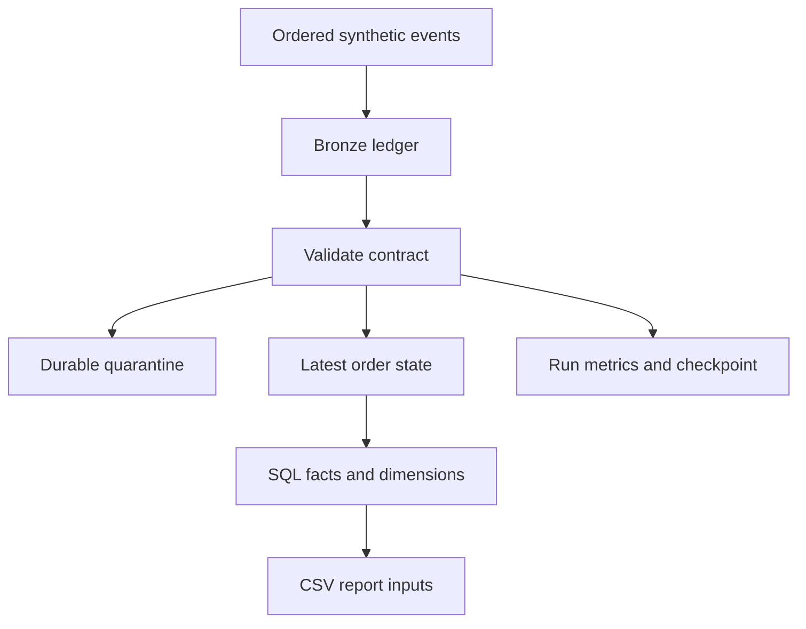

# Building a replay-safe retail ETL pipeline before deploying it to Fabric

**Editorial status:** implementation draft based on the delivered, tested local reference. Reproduce it yourself before publishing under your name. Replace the GitHub link template after publication. Azure/Fabric assets are not deployed or benchmarked in this article.

A retail sales total can be wrong even when an ingestion job finishes successfully. A cancelled order may still be counted. A corrected order may be inserted a second time. A retry may repeat a change that was already applied.

This example starts with those failure cases. The dataset is deliberately small and synthetic, so the expected result can be checked independently. The implementation uses Python and SQLite with no external dependencies. Fabric is the target architecture, but the local transaction boundary is not presented as a cloud guarantee.

## The business contract

Each order contains one product. Money is stored as integer cents in one currency. Each source change has an event ID representing a gap-free committed sequence in a single stream. This is a learning contract: ordinary SQL identity values are not necessarily committed in order and may have gaps. A production adapter must use its actual source offset semantics.

Three files describe an initial load, a change batch and corrections. The change batch includes a duplicate delivery, an update, a delete and two invalid events. The pipeline preserves raw events, rejects invalid business rows into quarantine and maintains the latest state per order.



## Two identities solve different problems

The event ID identifies a source change. The order ID identifies the business record. Repeating the same event must not repeat its effect; changing an order under a new event must update the business record.

An identical duplicate event is safe to ignore. Reusing an event ID with a different payload is an integrity failure, so the pipeline stops rather than choosing one version arbitrarily.

The current-state merge uses this condition:

```sql
ON CONFLICT(order_id) DO UPDATE SET
    quantity = excluded.quantity,
    unit_price_cents = excluded.unit_price_cents,
    is_deleted = excluded.is_deleted,
    last_event_id = excluded.last_event_id
WHERE excluded.last_event_id > orders.last_event_id;
```

This excerpt illustrates the version guard; the executable implementation also updates the remaining business fields and run ID. A delete is a tombstone, not removal of all knowledge that the order existed. That retained version prevents older changes from recreating deleted state.

## The checkpoint is part of publication

The local transaction includes bronze records, rejected rows, current-state changes, reconciliation and the checkpoint. The writer lock is acquired before reading the prior checkpoint.

```python
# A shortened description of the implemented boundary.
db.execute('BEGIN IMMEDIATE')
try:
    # Read checkpoint; validate contiguous window; write raw and current state.
    # Check accepted + rejected equals the new event count.
    # Update checkpoint and successful run audit.
    db.commit()
except Exception:
    db.rollback()
    # Record failure in a separate transaction, then re-raise.
    raise
```

A failure after merging but before committing therefore leaves the prior data and checkpoint intact. The included test injects that exact failure. This is stronger evidence than showing only one successful run.

## What happened in the synthetic demonstration

| Step | New events | Accepted | Rejected | Checkpoint | Current sales |
|---|---:|---:|---:|---:|---:|
| Initial load | 3 | 3 | 0 | 3 | $100 |
| Change batch | 5 | 3 | 2 | 8 | $125 |
| Identical replay | 0 | 0 | 0 | 8 | $125 |
| Corrections under new IDs | 2 | 2 | 0 | 10 | $165 |

These are test-fixture results, not production savings or a performance benchmark. Batch 2 contains six input rows because one event is delivered twice. Its five new events reconcile to three accepted and two quarantined events.

Event accounting and business-state accounting are different. Updates and deletes mean that counting accepted events will not yield the active order count. The final state has five active orders, and the tests separately assert its amount.

## Rejecting a row does not mean forgetting it

The two bad events are retained with reasons. This implementation advances past them only because quarantine is committed atomically with the checkpoint. A correction must carry a new event ID. The original evidence remains available.

This policy favors continued processing with visible exceptions. A financial close might require a stricter fail-the-batch policy. The contract should say which policy applies; a generic framework should not choose silently.

## How to reproduce

From the repository root:

```sh
python -m unittest discover -s tests -v
python src/pipeline.py load data/batch_001.jsonl
python src/pipeline.py load data/batch_002.jsonl
python src/pipeline.py load data/batch_002.jsonl
python src/pipeline.py load data/batch_003_corrections.jsonl
python src/pipeline.py export
```

The delivered run passed 15 tests. Coverage includes duplicate conflicts, missing events, malformed JSON, schema drift, bad types/dates, empty batches, replay, deletion, corrections and transaction rollback. This is functional validation for a small fixture, not evidence of high-volume reliability.

## What changes in Fabric

The target cloud architecture separates ADF source ingestion from Fabric orchestration, uses Delta for Lakehouse transformations and publishes validated gold tables in a Warehouse before reporting refresh.

Separate Delta and Warehouse writes do not share the local SQLite transaction. The cloud version needs immutable source windows, replay-safe writes and a publication ledger. It must tolerate failure between layers and withhold the published checkpoint until validation completes. That implementation and its failure tests are pending.

The Lakehouse SQL analytics endpoint provides a read-only query surface over Delta tables; the Warehouse SQL script is intended for a Warehouse. Keeping those surfaces distinct avoids building the plan around an unsupported write path.

## Next experiments

Add the actual source adapter, measure larger deterministic inputs, replace the sparse date dimension, validate cloud retries and test reporting security in the service. For now, the useful result is a small implementation with explainable behavior under failure.

Repository link template: https://github.com/RLolita-hub/fabric-platform-operations/tree/main/github/enterprise-fabric-platform

Official technical context:
- https://learn.microsoft.com/en-us/fabric/data-engineering/lakehouse-sql-analytics-endpoint
- https://learn.microsoft.com/en-us/fabric/data-factory/incremental-copy-job

## Publication plan

Opening: failed retries as a business correctness issue. Main code: event identity, merge version guard, transaction boundary. Diagrams: local flow and proposed cloud publication states. Screenshots to add after personal reproduction: test pass, failed run checkpoint, quarantine reasons and final SQL total. End with limitations and the next experiment. Avoid titles claiming a completed enterprise Fabric deployment.

Command working directory in this repository: `github/enterprise-fabric-platform/`.
