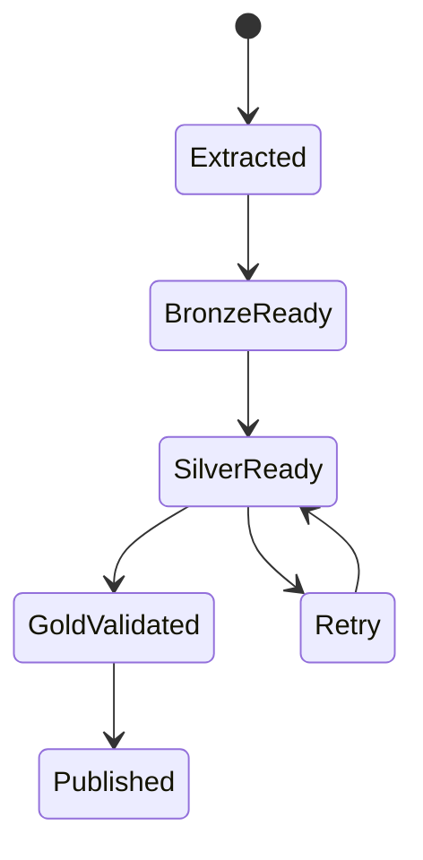

# Why a checkpoint belongs to publication, not extraction

*Technical article draft. Local behavior is tested; the cloud protocol below is proposed.*

A checkpoint is a promise about what the system has safely processed. Moving it as soon as a file is copied makes that promise too early. If transformation fails afterward, the next run may skip the unprocessed changes.

In the accompanying retail reference, the checkpoint shares a transaction with the bronze ledger, quarantine, current order state and success audit. `BEGIN IMMEDIATE` occurs before the checkpoint read. This serializes local writers rather than allowing two readers to independently assume ownership of the same interval.

## The failure that matters

Run the initial batch, then inject a failure:

```sh
python src/pipeline.py load data/batch_001.jsonl
python src/pipeline.py load data/batch_002.jsonl --fail-after-merge
```

The second command is expected to fail. The checkpoint remains 3. A successful retry can therefore process the same interval without losing changes. The test also confirms that the bronze and quarantine additions from the failed transaction are rolled back. Failure telemetry is written separately after rollback.

This is not an assertion about every possible failure. A process killed before failure telemetry is written may leave no FAILED audit record. A production orchestrator needs heartbeat and timeout handling as well as application logs.

## Cloud stages need a publication protocol

A Fabric notebook, a Delta table and a Warehouse publication do not become one transaction simply because one pipeline orchestrates them. The proposed state machine is:



Each state must refer to a durable source manifest and fixed source interval. Retrying after silver completes should reuse that interval and converge on the same silver state. Publishing gold must wait for checks on business keys, values and deletion state. Only then should the published checkpoint advance.

That protocol is a design proposal in this release. It needs failure tests at every transition before it can be called implemented.

## Three questions for a design review

First, what durable evidence proves a stage finished? A log line emitted before commit is insufficient. Second, who owns the interval if two schedulers fire? A transactional lease or equivalent serialization policy must be explicit. Third, what does a downstream reader see while a new release is incomplete? Serving only the last validated publication avoids exposing half-finished work.

The key lesson is not “put a watermark table somewhere.” It is to define exactly what the watermark acknowledges and demonstrate that retries preserve that meaning.

Code: https://github.com/RLolita-hub/fabric-platform-operations/tree/main/github/enterprise-fabric-platform

Reference: SQLite transaction documentation, https://www.sqlite.org/lang_transaction.html. It explains transaction behavior; the publication protocol here is the author's proposed architecture, not a claim made by SQLite.

Command working directory in this repository: `github/enterprise-fabric-platform/`.
