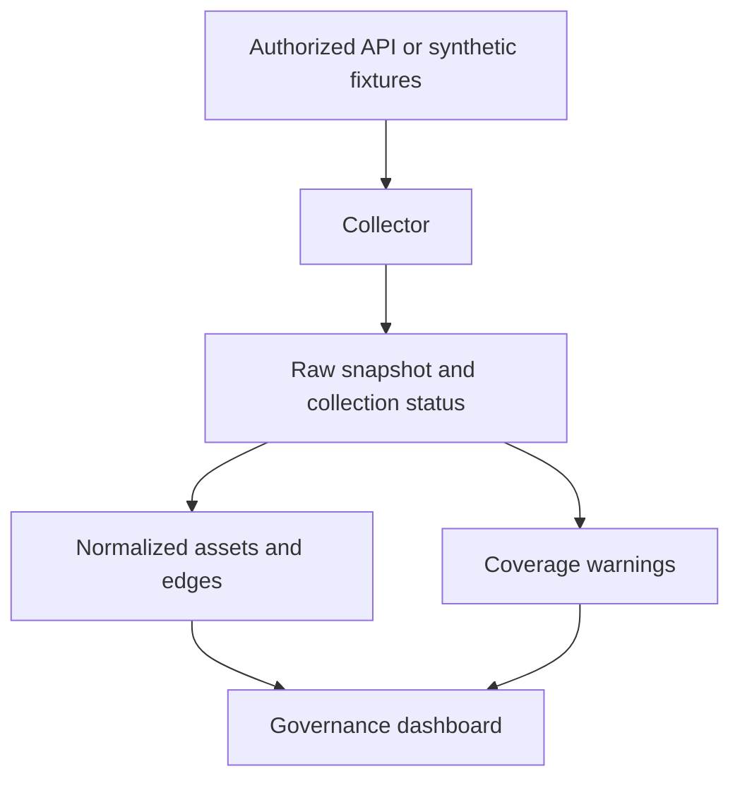

# Designing a governance catalog that admits what it cannot see

*Design article. The governance collector described here is planned, not deployed.*

A governance dashboard can be confidently wrong when a partial API scan is treated as a complete inventory. Missing permissions, failed pages and unfinished scans may resemble deleted reports or absent owners.

The first design requirement is therefore coverage visibility. Before presenting “reports without owners,” the collector must establish which workspaces and metadata fields it actually observed.

## Preserve collection context

Store a scan ID, requested scope, completion state, timestamps, response status and raw snapshot alongside normalized assets. An asset missing from one incomplete response must not immediately be marked deleted.

A proposed normalized model includes `workspace`, `asset`, `owner`, `dependency_edge`, `snapshot` and `collection_issue`. Stable IDs identify objects; names are display attributes. Two workspaces may contain reports with the same name.

## Inventory, lineage and refresh are separate concerns

An inventory lists assets. A dependency graph records relationships. Operational refresh history describes activity over time. They may require different endpoints and retention strategies; one scan should not be assumed to answer every question.

Represent uncertain edges explicitly. A relationship inferred from names is weaker evidence than a supported identifier relationship returned by the source. Keep the extraction method and confidence in the graph so consumers can assess it.

## A safe collector development path

Begin with synthetic responses. Test pagination, repeated objects, timeouts, permission denial, rate limits and incomplete scans. Only after those cases work should a lab administrator authorize real collection. Fabric metadata scanning requires administrator setup and appropriate tenant/API settings; fixture mode cannot prove those permissions work.

Use bounded retries for transient errors and stop on authorization failures. Repeatedly retrying a 403 does not solve access. Retain the previous successful snapshot while marking the newest attempt incomplete.

## What an honest dashboard would show

Display the latest complete snapshot time, requested versus observed scope, collection failures and stale assets. Show the ownerless-assets metric with its coverage boundary. When collection is incomplete, say so near the number rather than hiding the qualification in a footnote.

The most useful governance output is not the largest asset count. It is a catalog whose consumers can understand both the dependency evidence and its limits.

Architecture and roadmap: https://github.com/RLolita-hub/fabric-platform-operations

Reference: Microsoft, metadata scanning setup, https://learn.microsoft.com/en-us/fabric/admin/metadata-scanning-setup. This document supports the authorization prerequisite; the collector schema and failure policy above are proposed design choices.
