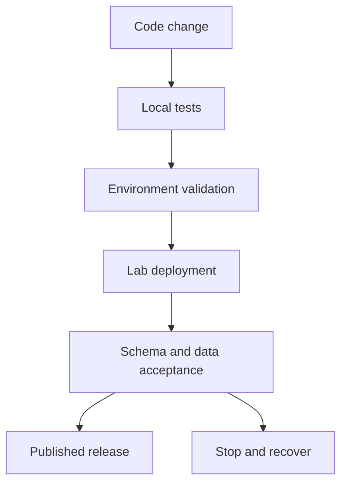

# Code passed CI. Is the data release ready?

*Design article with an authored local CI workflow; cloud deployment gates remain proposed.*

A Python test suite can pass while a release points to the wrong workspace. A schema change can deploy while a semantic model still expects the old column. Code validation and data publication need related but distinct checks.

The delivered repository includes a GitHub Actions workflow for local behavior tests and Python syntax checks. That is a useful first gate. It is not proof of Fabric deployment, permissions, refresh success or production readiness.

## Separate configuration from secrets

Environment configuration should identify the intended workspace, tables and source scope. Secrets should remain outside version-controlled files. Validate required configuration before starting a job, and avoid printing full connection objects when reporting an error.

A release gate should check the target environment rather than trusting a branch name. The deployment identity should have the minimum access needed for that environment. Broader privileges may hide missing access assumptions during testing.

## Validate the published contract

After a lab deployment, test that expected objects exist, schemas match, known fixtures reconcile and reporting refresh completes. Schema existence alone is insufficient: an empty table may technically satisfy a DDL check while breaking a report.

This diagram is a proposed cloud workflow. The implemented release evidence currently stops at local tests.

## Rollback needs state awareness

Reverting source code does not remove data already written with a new interpretation. A recovery plan must name the last validated publication, its schema, source manifest and dependent semantic model version. Rewinding a checkpoint while leaving newer target state in place can create another inconsistency.

For the small portfolio, the first rehearsal should intentionally fail reconciliation and prove the new publication remains blocked. A second rehearsal should restore the previous validated serving state. Record what was and was not restored.

## Useful evidence for an interview

Show a failed gate and its diagnostic output, not only a green workflow badge. Explain which failures are caught locally, which require an environment and which remain untested. That boundary is more informative than claiming a generic CI/CD implementation.

Repository: https://github.com/RLolita-hub/fabric-platform-operations
