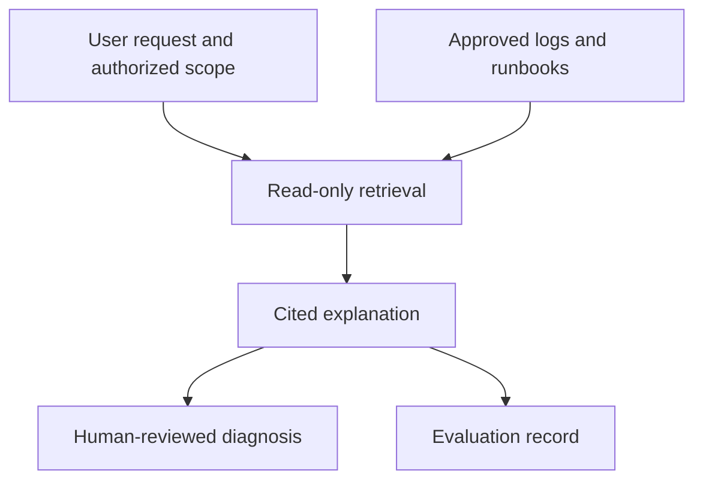

# A DataOps assistant should explain its evidence before suggesting a fix

*Design article. No AI agent is claimed as implemented in this repository.*

A pipeline log rarely contains the whole cause of an incident. It may show the point where a failure surfaced while the underlying issue is a missing object, changed schema or expired permission. A useful assistant should connect the log to approved metadata and runbooks without inventing missing facts.

The proposed first version is read-only. It retrieves a bounded set of synthetic logs and runbooks, identifies relevant passages and returns a cited explanation. SQL fixes remain suggestions for review; the assistant does not execute them.

## Start without a model

Build deterministic retrieval and metadata lookup first. If an exact pipeline ID cannot be resolved reliably, adding an LLM does not repair the underlying catalog. Create fixtures for known failures and make the retrieved evidence visible.

An answer should distinguish observation, hypothesis and next diagnostic step. For example, “the log reports a missing column” is an observation. “The upstream schema changed” may be only a hypothesis until metadata supports it.

## Treat retrieved text as untrusted

A log entry may contain instructions planted by a user or source system. Those strings are evidence to analyze, not instructions that grant tools or change the assistant's scope. Tool access should be enforced by the application, with allowlisted read operations and validated arguments.

## Measure more than fluency

The proposed evaluation set includes answerable incidents, missing evidence, ambiguous failures, cross-scope requests, prompt injection and secrets embedded in logs. Record whether retrieval found the right evidence, whether the explanation cites it correctly and whether the assistant abstains when it should.

A confident answer without a supported citation should fail the evaluation. So should a useful diagnosis that exposes a secret. Response quality includes both usefulness and the boundaries respected.

## Keep actions separate

If write actions are added later, approval must bind to an exact payload, target and expiry. “Approved this conversation” is too vague for an executable SQL change. Read-only reasoning can be useful long before that higher-risk capability is justified.

This is a build specification, not an evaluation report. The next step is to implement the fixture corpus and read-only retrieval tests, then report observed outcomes without fabricated accuracy scores.

Design repository: https://github.com/RLolita-hub/fabric-platform-operations
