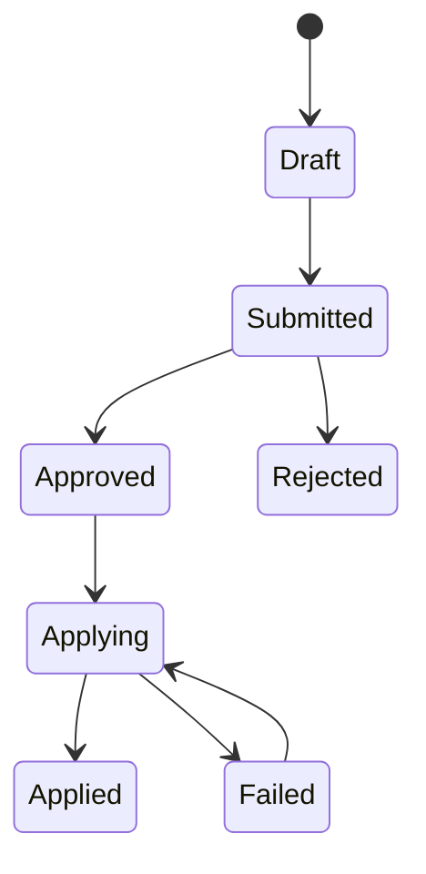

# A data-correction approval should authorize a version, not just a request

*Design article for a planned Power Apps/Power Automate learning project.*

A correction form looks simple: choose a record, enter a value and ask someone to approve it. The difficult question is what happens if the request changes while approval is pending, or if the workflow delivers the same approval twice.

The proposed application handles quality exceptions from a data pipeline. Each request refers to an exception ID and includes a version, proposed values, reason, submitter and approval status. An approval authorizes that exact version.

## Keep the raw evidence immutable

The retail reference already retains invalid source events in quarantine. The application should not edit those records to make the original input appear valid. Instead, a successful correction emits a new source event and links it to the original exception.

This preserves the difference between “the source was valid” and “a problem was corrected later.” That distinction matters for both troubleshooting and audit.

## Model the workflow explicitly

Each transition has an authorized actor and validation rule. If a submitted payload changes, increment its version and invalidate the earlier approval. A retry of Applying should reuse the same idempotency key so it cannot apply the business change twice.

## Approval is not validation

Even an approved request can become invalid because the target record changed. Before applying it, recheck the expected current version, allowed range and business rule. An optimistic concurrency failure should return the request for review rather than overwrite newer information.

The audit record should store who approved, which version they saw, when the command was emitted and which pipeline run applied it. Email delivery is not proof that a correction reached the target.

## Build and test in a lab

The first implementation would use a Power Apps form, Dataverse request records and a Power Automate approval flow in an authorized development environment. Test double submission, stale approvals, unauthorized approvers, rejection, timeout and downstream failure. Development entitlements do not automatically establish production licensing.

No exported Power Platform solution or successful workflow execution is claimed in this release. The design is intentionally specific enough to implement and test, rather than a screenshot presented as a completed operations system.

Design repository: https://github.com/RLolita-hub/fabric-platform-operations

Reference: Power Apps Developer Plan, https://learn.microsoft.com/en-us/power-platform/developer/plan. The versioning and idempotency policy above is a proposed application design.
