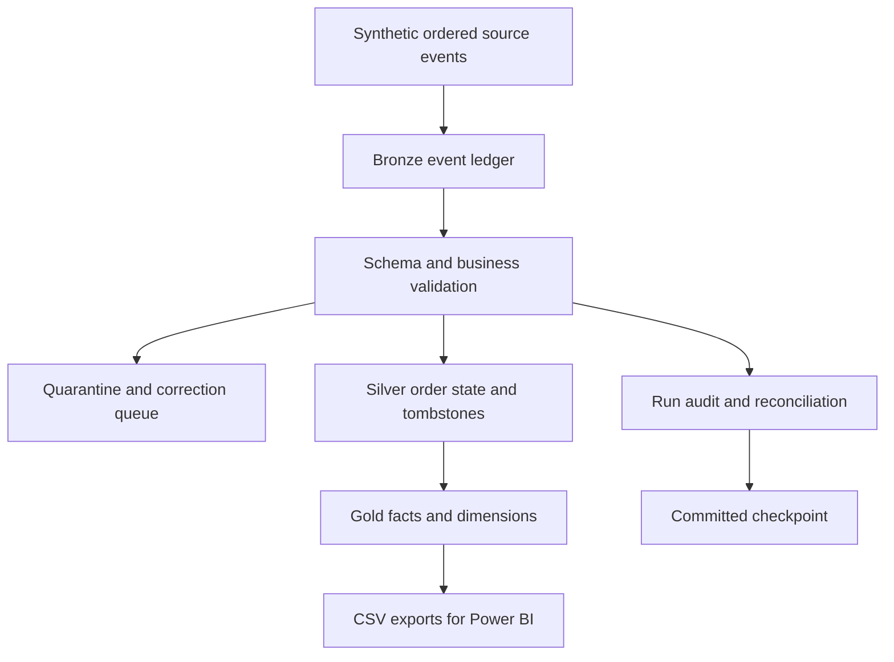

# Enterprise Fabric Platform — reliable retail order processing

**Status: local reference implementation tested; Fabric/Azure deployment pending.**

A synthetic retailer needs reliable daily sales totals despite corrected orders, cancelled orders, duplicate deliveries, invalid source records, and failed loads. This repository makes those failure cases reproducible before moving processing to Fabric.

## What is implemented

- Python ingestion with strict schema and business validation.
- Immutable bronze event ledger, durable quarantine, latest-state silver orders, SQL gold views.
- Ordered incremental checkpoints, duplicate delivery handling, tombstones, atomic local publication.
- Run IDs, input SHA-256 fingerprints, durable failure logs, event-level reconciliation.
- CSV exports for Power BI and 15 executable tests, plus GitHub Actions configuration.

No paid service, dependency installation, client data, or secret is needed for the local path. Requires Python 3.10+; verified here with Python 3.12.14. Use `python` on Windows, `python3` if needed on macOS/Linux. Run commands from this directory.

```sh
python -m unittest discover -s tests -v
python src/pipeline.py load data/batch_001.jsonl
python src/pipeline.py load data/batch_002.jsonl
python src/pipeline.py load data/batch_002.jsonl
python src/pipeline.py load data/batch_003_corrections.jsonl
python src/pipeline.py export
```

Expected: checkpoint 3 → 8 → 8 → 10; accepted events 3 → 3 → 0 → 2. Batch 2 receives 6 rows, including one duplicate; 5 new events = 3 accepted + 2 quarantined. Final active orders = 5; revenue = **16,500 cents ($165.00)**. These tiny synthetic totals validate logic, not scale or business impact. To start another run without deleting anything, use `python src/pipeline.py --db build/another.db load data/batch_001.jsonl`.

## Evidence and implementation boundaries

[evidence/test-results.txt](evidence/test-results.txt) contains the executed local test output. [evidence/demo-results.json](evidence/demo-results.json) records the end-to-end demonstration. GitHub Actions is authored but has not run on GitHub. The PySpark, Warehouse SQL and DAX assets are implementation starters, not cloud-tested deliverables. There is no PBIX, deployed ADF pipeline, published Fabric workspace, measured cloud speedup, or production SLA claim in this release.

## Architecture



The local ledger, accepted changes, rejected records and checkpoint commit in one SQLite transaction. A failure rolls them back while the error audit commits separately. This does **not** imply atomic cross-table transactions in Fabric. See [cloud architecture](docs/architecture.md).

## Data contract

Grain is **one order with one product**, not an order with multiple order lines. `event_id` represents an upstream, gap-free, committed event sequence for one stream. It is not a business date, identity column, or SQL Server CDC LSN. An identity value may contain gaps or commit out of order and cannot be substituted blindly. Production CDC adapters need their real offset semantics.

Input JSONL fields: event_id (positive integer), order_id (positive integer), operation (UPSERT/DELETE), order_date (ISO date), region (East/West/South/Central), product_id (positive integer), quantity (1–100,000), unit_price_cents (0–100,000,000). All fields are required, even on DELETE in this learning contract. USD only; integer cents avoid floating point drift. Corrections carry a **new event ID**. Previously rejected events stay in quarantine for audit; they are not silently edited.

## Repository map

| Directory | Purpose |
|---|---|
| src/ | Executable local ingestion, exports, deterministic fixtures |
| tests/ | Behavior tests for data loss and failure risks |
| data/ | Public-safe synthetic event batches |
| sql/ | Executed SQLite model |
| cloud/ | Untested Fabric PySpark and Warehouse starter assets |
| powerbi/ | DAX measures and model instructions; no report file yet |
| docs/ | Architecture, deployment, runbook, interview and demo guide |
| evidence/ | Actual local outputs |
| .github/workflows/ | Local test automation for GitHub |

## Limitations worth discussing in an interview

The input is read in memory; SQLite serializes writers; dimensions are current-state and natural-key based; date dimension is sparse; quarantine uses a tolerate-and-alert policy; no retention purge, multi-currency, SCD2, or upstream connector is implemented. Unexpected process termination can leave no failed-run audit row, requiring an external orchestrator heartbeat in production. Input sequence gap validation deliberately prioritizes completeness over availability. These choices are explicit learning constraints, not a production scalability claim.

[Cloud deployment](docs/deployment.md) · [Debugging and interview practice](docs/runbook.md) · [Power BI build](powerbi/README.md)
