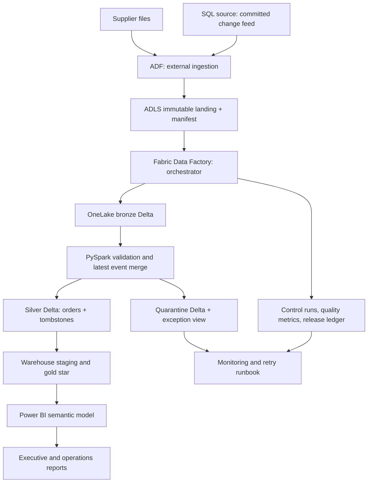

# Flagship target architecture

## Scenario and scope

A fictional regional retailer receives daily order changes from a transactional system and product extracts from a supplier. Finance wants consistent sales totals; operations needs visible data exceptions. Start with a single-product-per-order fact, then add order lines and returns only after the first release is verified. Target batch freshness: one successful daily publication by 08:00 ET, a proposed requirement, not an achieved SLA.

## Cloud target — not yet deployed

ADF owns source connectivity and immutable landing only. Fabric Data Factory owns downstream orchestration only. Do not run duplicate schedules for the same transform in both. The cheaper first Fabric exercise uploads synthetic JSONL directly and bypasses ADF/ADLS; adding the external ingestion leg is a separate milestone.

## Control plane

Each run has pipeline name, environment, run ID, source lower/upper offsets, manifest checksum, bronze/silver/Warehouse publication state, accepted/rejected event counts, current-state reconciliation, start/end times, error class and retry count. Capture an immutable upper bound from a committed source feed; process `(last_published_offset, upper_bound]`. Persist files plus manifest before processing. Skip neither a missing file nor an unaccounted event.

Data flow states: EXTRACTED → BRONZE_READY → SILVER_READY → GOLD_VALIDATED → PUBLISHED. Checkpoint advances only after gold validation and publication. On retry, reuse source window and manifest; each sink must be independently replay-safe. Do not call this distributed exactly-once execution: it is at-least-once processing with idempotent state convergence and a publication ledger.

Serialize one run per entity initially. Use the orchestrator concurrency limit plus a transactional control-store lease before scaling. A scheduler flag alone is insufficient across separate pipeline definitions. In production use a transaction-capable control store or an explicit lease service; the included local SQLite lock does not implement a cloud lease.

## Storage design

| Layer | Grain/key | Design |
|---|---|---|
| Landing | source/window/file | Immutable JSON/Parquet and manifest, run ID path |
| Bronze | event ID | Raw payload + ingest time + source offset; idempotent event ingestion |
| Quarantine | event ID + rule | Raw payload, reason, first seen, resolution link |
| Silver | order ID | Latest version, last event ID, deletion tombstone |
| Gold fact | order ID (one product per order) | Date, region, product keys; quantity and integer cents |
| Gold dimensions | date, region, product | Initially Type 1; SCD2 is a later explicit extension |
| Audit | run ID/entity | Counts, source hash, offsets, status, error, durations |

Use low-cardinality partitions only if data volume warrants them; do not partition tiny demo tables or partition by order ID. Preserve tombstones so old replays cannot resurrect deletions. Source sequence beats order date for changes arriving late relative to business time. If the source only supplies an updated timestamp, use an overlap window, source-key tie-breaker, and periodic reconciliation; document that hard deletes need CDC or snapshots.

## Validation and publication

1. Required columns and types; IDs positive; valid date, region, operation and monetary bounds.
2. Conflicting duplicate event ID fails the run; identical transport duplicates are ignored.
3. Reconcile events: new bronze = accepted + quarantined. This is **not** a comparison of events to current fact rows.
4. Independently reconstruct expected current state from the accepted source stream and compare keys, amounts and delete status to silver.
5. Validate unique fact grain, dimension coverage and aggregated cents in Warehouse.
6. Publish a new gold snapshot atomically in Warehouse; refresh the semantic model only on success.
7. Retry transient connectivity with bounded backoff; route schema and contract failures to investigation.

The included local tests verify the first-stage single-store behavior. Cloud failure injection must be repeated at every boundary; Delta commits are table-scoped, not an all-layer transaction.

## Security and operations

Use personal lab tenants and synthetic data. Separate dev/test workspaces; least-privilege source read, landing write, transform write and BI viewer roles. Use managed identities or supported workload identities where available; service-specific connection support must be checked. Keep secrets in an approved secret store, not parameter files. Restrict metadata extraction to the lab scope. A shared semantic model's RLS does not secure direct access to underlying Lakehouse data. Test both BI viewer and direct-data permissions.

CI runs Python tests and syntax checks. Cloud release gate checks workspace identity, table schema, source-window reconciliation, RLS fixtures and refresh success. Roll back gold publication to the last validated snapshot, never simply rewind an ingestion checkpoint after publishing newer state. Archive manifests and recoverable source windows before retention expiry.

## Decision records

- ADR-001: local SQLite for deterministic, no-cost failure testing; no claim of distributed equivalence.
- ADR-002: integer cents for a single currency; widen to decimal with currency grain for multi-currency.
- ADR-003: tombstones for safe replay; retention must exceed the maximum replay horizon.
- ADR-004: quarantine and acknowledge known-invalid business rows; alert and resubmit corrections under new sequence IDs. Critical datasets may instead use fail-the-batch policy.
- ADR-005: Fabric Lakehouse for Spark transforms; Warehouse for governed SQL serving. The Lakehouse SQL endpoint reads Delta data; it is not the write target for Warehouse DDL/DML.
