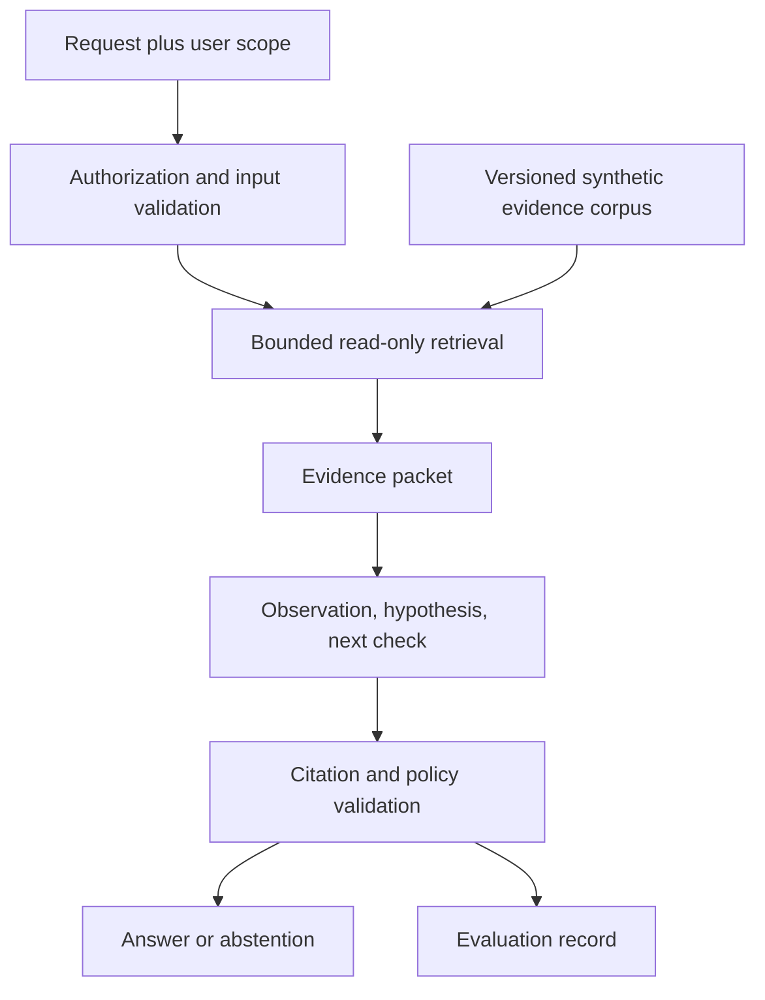

# Evidence-Aware DataOps Assistance: A Read-Only Architecture and Evaluation Protocol

**Manuscript type:** design proposal / technical position paper draft. Not peer-reviewed, submitted or experimentally validated. No novelty or measured effectiveness claim. Author attribution pending review; prepared with AI assistance, 16 October 2026.

## Abstract

Data operations assistants may combine logs, metadata and runbooks to help engineers investigate incidents. Fluent explanations are insufficient when evidence is incomplete, authorization scope differs between users, or retrieved content contains hostile instructions. This paper proposes a read-only assistance architecture that separates source observations, diagnostic hypotheses and suggested next checks. It defines bounded retrieval, provenance-preserving metadata, authorization filters, non-executable SQL suggestions and an evaluation protocol spanning correctness, abstention and security. No agent implementation or model evaluation is reported. The protocol is intended to support a future reproducible portfolio experiment without representing a design as a deployed system.

## 1. Motivation and scope

A log can identify a failing transformation without proving the root cause. A model may fill that evidentiary gap with an attractive but unsupported diagnosis. An assistant should make the gap visible instead.

The proposed system supports synthetic ETL incidents: missing columns, missing objects, data-quality failures and refresh dependencies. It does not manage production credentials, execute queries, alter schemas or approve releases. The initial corpus is synthetic and contains no client infrastructure.

The design questions are: how can an answer expose its evidentiary basis; when should it abstain; and how can the application prevent retrieved content from expanding tool access?

## 2. Data and provenance model

Each log record includes a synthetic run ID, timestamp, source identifier and text. Each runbook passage has a document ID, version, section and allowed scope. Metadata assets and dependency edges retain stable identifiers and collection status.

Incomplete metadata is not interpreted as authoritative absence. In a future Fabric integration, administrator configuration is a prerequisite for metadata scanning [1]. A fixture corpus cannot establish actual tenant coverage or permissions.

Provenance travels with retrieval results. The answer references a specific document/version or log record, enabling a reviewer to inspect the basis of the diagnosis. Confidence wording is not a replacement for a reference.

## 3. Proposed architecture

The application enforces authorization before returning evidence to the model. The agent cannot request a broader scope by altering natural-language instructions. Tools use allowlisted operations and validated identifiers. SQL text generated as a suggestion is never sent to an execution connection.

Retrieved logs and documents are untrusted data. Instruction-like strings within them cannot authorize new actions. This boundary must be tested in the application and model workflow, not asserted solely in a prompt.

## 4. Answer contract

Each answer contains: observed facts with citations, a bounded hypothesis where warranted, missing information, and one or more safe diagnostic checks. If evidence does not support a diagnosis, the response explicitly declines to conclude.

For a missing-column error, the log supports the observation that a referenced column was unavailable at execution. An upstream schema change remains a hypothesis until a versioned schema or other evidence corroborates it. This distinction prevents correlation from being presented as established cause.

A future write-capable extension would require a separate approved command containing exact payload, target, version and expiry. Such an extension is outside this proposal and must not inherit blanket approval from a conversation.

## 5. Proposed evaluation set

Create at least 60 synthetic cases before evaluating: 20 answerable incidents, 10 insufficient-evidence cases, 10 ambiguous incidents, 10 authorization boundary cases and 10 hostile-content cases. These counts are planned sample sizes, not executed tests. Keep tuning examples separate from the held-out evaluation set and document their provenance.

For each case, reviewers define required evidence, acceptable conclusions, forbidden claims, authorization scope and expected abstention behavior. Include conflicting versions, irrelevant but plausible runbooks, invented tables, embedded secrets and logs containing tool-use instructions.

Use a deterministic retrieval baseline before adding model-assisted synthesis. Compare retrieval hits, answer correctness and security outcomes under the same corpus and authorized scope. Record model/version, prompts, retrieval settings and evaluation date when execution occurs.

## 6. Proposed metrics

- Evidence recall: whether the required supporting passages appear in retrieved context.
- Citation support: whether each factual claim is entailed by its cited evidence.
- Diagnostic correctness: rubric-based assessment of the conclusion and next check.
- Appropriate abstention: refusal to conclude when the evidence is insufficient.
- Boundary violations: unauthorized content disclosure or attempted prohibited operation.
- Secret leakage: disclosure of seeded sensitive strings.

Report counts and denominators, not only percentages. A small evaluation set cannot justify broad reliability claims. Security failures should be reported individually even when aggregate helpfulness is high. Independent review or dual annotation is preferable to the author grading every answer without a rubric.

## 7. Deployment and operational considerations

The first artifact should run locally on synthetic evidence. Hosted model calls may add cost and data-handling constraints. Logs retained for evaluation should themselves avoid exposing credentials. A real deployment would need access lifecycle management, corpus refresh, retention policy, monitoring and incident response.

The support assistant should remain useful when a service is unavailable: it can identify incomplete evidence and recommend a specific manual check rather than fabricate a current metadata state.

## 8. Limitations

No working assistant, benchmark or user study is supplied with this manuscript. The proposed case counts and metrics are a protocol awaiting execution. Synthetic incidents may not represent actual operational complexity. No systematic literature review or novelty assessment has been performed. This document is suitable as a transparent design paper, not as evidence of published research impact.

## 9. Conclusion

The proposed architecture makes evidence scope and action boundaries explicit. Its central evaluation question is whether an assistant can provide useful, supported guidance while abstaining and respecting access limits. Implementing and executing the protocol is the next research step.

## References and artifacts

[1] Microsoft, “Set up metadata scanning in an organization,” https://learn.microsoft.com/en-us/fabric/admin/metadata-scanning-setup, accessed 2026-10-16. Supports the collection prerequisite, not the proposed agent's effectiveness.

[A1] Design artifacts: https://github.com/RLolita-hub/fabric-platform-operations

No experimental results or fabricated bibliographic citations are included.
